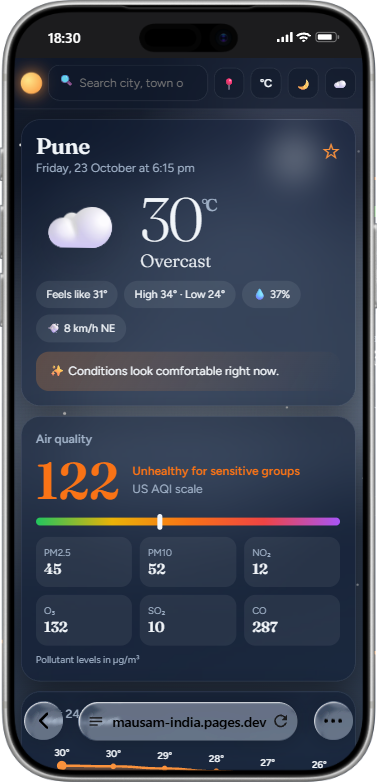
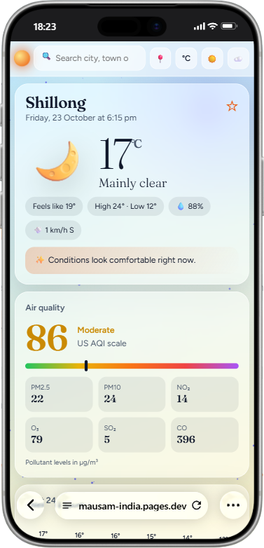
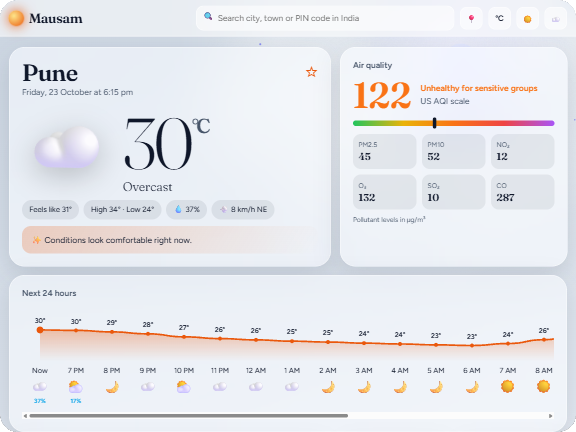

<p align="center">
  
</p>

<h1 align="center">Mausam India</h1>

<p align="center">
  Your weather, beautifully presented.
  <br>
  Live weather, forecasts and air quality across India.
</p>

<p align="center">
  <a href="https://mausam-india.pages.dev">🌐 Live Website</a>
  &nbsp; • &nbsp;
  <a href="#-mobile--tablet-preview">📱 Mobile Preview</a>
</p>

---

A responsive, animated India-focused weather dashboard built from the supplied `wherther index.html` and packaged for Cloudflare Pages.

## What's included

- Current weather and feels-like temperature
- Hourly chart and 7-day forecast
- Air-quality index and common pollutant readings when the provider has them
- Search for Indian city/town names and supported postal codes
- Browser geolocation, °C/°F, light/dark/automatic theme, favorites saved locally
- Cloudflare Pages Functions that proxy a fixed list of Open-Meteo endpoints and edge-cache forecast, air-quality, and geocoding responses
- Optional Supabase email-link sign-in and cloud-synced favorites, disabled until you add your own project URL and public key
- No framework, build step, weather API key, or paid server required

## Coverage notes

The dashboard can request weather by latitude and longitude, so it is not limited to the 12 quick-city buttons. The geocoding API returns indexed locations and supported postal-code matches in India; it cannot guarantee that every village name or every PIN code is indexed. Weather precision also depends on the forecast model and location grid, not merely the website.

## Deploy to Cloudflare Pages for free

1. Create a GitHub repository and upload the **contents** of this folder (`public/`, `functions/`, `supabase/`, and this README) to its root.
2. In Cloudflare, open **Workers & Pages → Create → Pages → Connect to Git** and connect that repository.
3. Choose no framework. Leave the build command empty and set the build output directory to `public`. Keep `functions/` at the repository root (next to `public/`), not inside `public/`.
4. Deploy. Keep the `functions/` directory at the root so the `/api/*` endpoints are deployed with the site.
5. Open the `*.pages.dev` URL and test the dashboard, search, favorites, and location permission.

Do not use a plain static drag-and-drop deployment if you want the `/api/*` Functions to run. Use Git integration, or deploy Pages Functions with Wrangler. The `public/_routes.json` file limits Function execution to `/api/*`, so static assets remain on the unlimited static-asset path.

## Local preview

- Opening `public/index.html` directly, or serving it from `localhost`, uses Open-Meteo directly so you can preview the UI.
- For a local test of the Cloudflare cache/proxy functions, install Node.js and run from this folder:

```bash
npx wrangler pages dev public
```

Then open the local URL printed by Wrangler (Wrangler uses port `8788` by default, which enables the local `/api/*` proxy). Test endpoints such as `/api/forecast?latitude=28.61&longitude=77.21&current=temperature_2m` and `/api/geocoding?name=Ranchi&count=3&language=en&format=json&countryCode=IN`.

## Free-plan and provider notes

- Cloudflare Pages static asset requests are free and unlimited on the Free plan. Pages Functions share the Cloudflare Workers Free quota of 100,000 requests per day. If that limit is reached, dynamic API routes can stop working until the quota resets.
- Open-Meteo's public API is free for **non-commercial** use under its published limits and attribution terms. This project credits Open-Meteo in the footer. A commercial or ad-monetized deployment may require a commercial licence; verify the current provider terms before monetizing.
- Edge-cache lifetimes in this project are 10 minutes for forecasts, 15 minutes for air quality, and 24 hours for geocoding. The API provider may update its data on a different schedule.

## Why Supabase is not required for v1

Weather forecasts, geocoding, and air-quality data come from Open-Meteo, not Supabase. The site works immediately and saves favorites in `localStorage`; cloud-sync is an optional feature in this bundle that activates only after you configure Supabase. Supabase does not improve the weather feed itself, so the core site intentionally keeps working even if cloud sync is not set up or a free Supabase project pauses after low activity.

## Important limitations

- This is a free-tier hobby/educational setup, not a guaranteed uptime or emergency-alert service.
- API provider availability, free-plan limits, weather model resolution, and geocoder indexing can change.
- Official IMD severe-weather alerts, radar, and push notifications are not included. Optional authentication and cross-device favorite sync require Supabase setup.

## Optional Supabase cloud-sync setup

The weather dashboard itself does **not** need Supabase. Enable it only if you want saved locations to follow a user across devices.

1. Create a Supabase Free project.
2. Open **SQL Editor** and run `supabase/schema.sql`.
3. In `public/index.html`, fill `SUPABASE_URL` and `SUPABASE_ANON_KEY` with the Project URL and the publishable/anon public key from Supabase project settings. Do not use a `service_role` or secret key in browser code.
4. In Supabase **Authentication → URL Configuration**, set your deployed `https://<your-project>.pages.dev` address as the Site URL and add the same address as an allowed redirect URL. Enable email sign-in/magic links.
5. Redeploy the updated HTML to Cloudflare Pages. Click the cloud icon, enter your email, and follow the link.

Row Level Security is enabled in the provided SQL, and policies restrict each signed-in user to their own saved locations. Keep the public anon/publishable key paired with those policies. Supabase Free may pause low-activity projects after 7 days; live weather remains independent, but cloud sync will be unavailable until the project resumes.

## 📱 Mobile & Tablet Preview

Mausam India adapts to phone and tablet screens, with both light and dark themes.

<p align="center">
  

  <br>
  
  
</p>

### Tablet Preview

<p align="center">
  
</p>

# Mausam India — Scroll Animation Update

This package adds subtle scroll-triggered reveal animations to hourly forecast items, 7-day forecast rows, pollutant cards, quick-city cards, inline weather recommendation pills, detail cards, and the AQI history chart. The animation runs once as each item enters view and respects `prefers-reduced-motion`.

## Deploy

1. Replace your existing `index.html` with this package's `index.html`.
2. Keep `functions/[[path]].js` under the same `functions` directory in your Cloudflare Pages project.
3. Preserve any newer footer GitHub link/developer credit you added after the source copy used for this update.
4. Commit and push to the production branch connected to Cloudflare Pages.

The AQI history remains a model-based CPCB-style estimate, not an official CPCB monitoring-station record.
