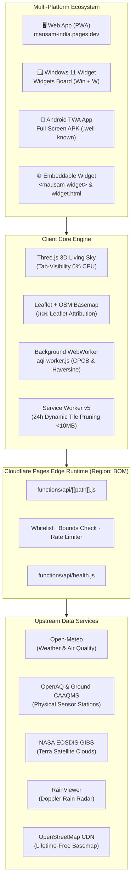

# 🇮🇳 Mausam India (मौसम इंडिया)

```text
███╗   ███╗ █████╗ ██╗   ██╗███████╗ █████╗ ███╗   ███╗    ██╗███╗   ██╗██████╗ ██╗ █████╗
████╗ ████║██╔══██╗██║   ██║██╔════╝██╔══██╗████╗ ████║    ██║████╗  ██║██╔══██╗██║██╔══██╗
██╔████╔██║███████║██║   ██║███████╗███████║██╔████╔██║    ██║██╔██╗ ██║██║  ██║██║███████║
██║╚██╔╝██║██╔══██║██║   ██║╚════██║██╔══██║██║╚██╔╝██║    ██║██║╚██╗██║██║  ██║██║██╔══██║
██║ ╚═╝ ██║██║  ██║╚██████╔╝███████║██║  ██║██║ ╚═╝ ██║    ██║██║ ╚████║██████╔╝██║██║  ██║
╚═╝     ╚═╝╚═╝  ╚═╝ ╚═════╝ ╚══════╝╚═╝  ╚═╝╚═╝     ╚═╝    ╚═╝╚═╝  ╚═══╝╚═════╝ ╚═╝╚═╝  ╚═╝
```

[](https://pages.cloudflare.com/)
[](LICENSE)
[](#-non-commercial-student-project-notice)
[](https://mausam-india.pages.dev/api/health)
[](https://mausam-india.pages.dev/)
[](https://web.dev/progressive-web-apps/)
[-0078D4?style=for-the-badge&logo=windows11&logoColor=white)](https://learn.microsoft.com/en-us/microsoft-edge/progressive-web-apps-chromium/how-to/widgets)
[](https://developer.chrome.com/docs/android/trusted-web-activity/)
[](#-embeddable-web-widget--web-component)
[](https://threejs.org/)
[](https://leafletjs.com/)

---

## 🌐 Live Production & Edge Gateway

- **Live Production URL**: [https://mausam-india.pages.dev](https://mausam-india.pages.dev)
- **Live Edge Health API**: [https://mausam-india.pages.dev/api/health](https://mausam-india.pages.dev/api/health)
- **Embeddable Widget**: [https://mausam-india.pages.dev/widget.html](https://mausam-india.pages.dev/widget.html?city=New%20Delhi&theme=dark)
- **GitHub Repository**: [https://github.com/himanvic/Mausam-India](https://github.com/himanvic/Mausam-India)

---

## 📖 Overview

**Mausam India** is a modern, high-performance, and privacy-first meteorological web application and cross-platform widget ecosystem engineered specifically for the Indian subcontinent. It unifies real-time atmospheric modeling, CPCB-style Air Quality Index estimates, physical CAAQMS ground-level sensor telemetry via OpenAQ, genuine orbital satellite cloud imagery from NASA, interactive Doppler precipitation radar, multi-hazard early warning docks, and native device Web Notifications into a seamless, responsive interface.

Built to run at the edge on **Cloudflare Pages**, Mausam India expands beyond the browser into:
1. **Windows 11 Native PWA Desktop Widgets** (<kbd>Win</kbd> + <kbd>W</kbd>) using Microsoft Adaptive Cards v1.5.
2. **Android Trusted Web Activity (TWA)** packages with verified Digital Asset Links for full-screen, address-bar-free standalone app installation.
3. **Drop-in Embeddable Web Components (`<mausam-widget>`)** for Indian schools, non-profits, and educational blogs.
4. **Dedicated Background WebWorkers (`aqi-worker.js`)** offloading heavy mathematical sliding-window calculations from the main UI thread.

> [!NOTE]
> **Independent Project Notice**: Mausam India is an independent open-source weather platform and is not affiliated with, authorized, sponsored, or endorsed by the India Meteorological Department (IMD), the Ministry of Earth Sciences (MoES), or the Government of India. For official governmental advisories and storm warnings, please visit [mausam.imd.gov.in](https://mausam.imd.gov.in).
>
> **Non-Commercial Student Project Notice**: Mausam India is developed strictly as a free, non-commercial student project for educational, meteorological research, and civic awareness purposes. It contains zero advertisements, zero monetized services, and zero subscription paywalls. *Commercial Notice: Should commercial features, advertisements, or monetization ever be introduced in the future, the terms of service of upstream providers (notably Open-Meteo and RainViewer) must be reviewed and upgraded to commercial licensing tiers.*

---

## 🌟 Key Features

### 1. 🌦️ Procedural 3D WebGL Living Sky (Three.js) & Tab-Visibility Power Saving

- **Living Atmosphere**: Real-time celestial rendering featuring a procedural Sun with corona bloom, 1,200 scintillation stars, multi-altitude drifting 3D clouds, vertical rain streaks, dynamic lightning flashes, and low-altitude fog layers.
- **Mouse Parallax**: Smooth cursor tilt interactions on widescreen displays.
- **Tab-Visibility Battery Saving (0.0% Background CPU)**: Halts the WebGL canvas loop, fallback 2D particle simulation, 420-particle wind streamline physics, and radar playback intervals immediately whenever the browser tab is hidden or minimized (`document.hidden`), ensuring zero background battery drain on laptops and smartphones.

### 2. 🤖 "Mausam Mitra" Dynamic Weather Companion

- **Adaptive Vector Mascot**: Built entirely from clean procedural SVG vectors (original SVG artwork made for this project).
- **Context-Aware States**:
  - **Pollution Alert (AQI $\ge 200$)**: Automatically equips a fitted N95 respirator mask with particulate valves and displays air health cautions.
  - **Precipitation**: Holds an umbrella with water-repellent bounce animations when rain or storms are imminent.
  - **High UV / Heatwave ($\ge 38^\circ\text{C}$)**: Wears dark sunglasses and triggers hydration advisories.
  - **Winter Chill ($< 14^\circ\text{C}$)**: Wraps in a warm knitted muffler.
  - **Starlit Night**: Holds an illuminated warm lantern.
- **Micro-Interactions**: Click or tap Mausam Mitra to cycle through contextual weather tips with physics-based wobble animations.
- **Fully Responsive**: Fills widescreen hero space on desktop and automatically reorganizes into a compact horizontal companion on mobile phones ($\le 900\text{px}$) with zero screen overflow.

### 3. 🚨 In-App Multi-Hazard Early Warning Engine (`#alertDock`)

- **Top-Level Multi-Hazard Dock**: Dedicated glassmorphic alert container positioned prominently at the top of the viewport, capable of presenting multiple concurrent hazards (e.g. Severe Smog + Dense Fog) without distorting card layouts.
- **Indian Meteorological & CPCB Threshold Evaluations**:
  - **CPCB Severe Smog**: Triggers on AQI >400 (*Critical Severe*), 301–400 (*Very Poor*), and 201–300 (*Poor*) with N95 mask recommendations and direct navigation links to the pollutant breakdown.
  - **IMD Severe Heatwave / Loo**: Evaluates temperatures $\ge 43^\circ\text{C}$ or apparent temperatures $\ge 46^\circ\text{C}$, plus high temperature advisories ($40^\circ\text{C}$–$42.9^\circ\text{C}$), with hydration and midday exposure guidance.
  - **Active Thunderstorm & Lightning**: Evaluates WMO convective storm codes (95, 96, 99) with lightning safety rules and quick jumps to the live Doppler radar.
  - **Heavy Monsoon Downpour**: Detects intense rainfall rates ($\ge 10\text{mm/h}$) and high precipitation probabilities ($\ge 80\%$) with flash waterlogging driving precautions.
  - **Dense Winter Fog**: Evaluates visibility $\le 350\text{m}$ and fog codes (45, 48) with highway fog-lamp safety advisories.
  - **Extreme UV Radiation**: Alerts when daytime UV index reaches $8+$ with skin protection guidance.
  - **Cold Wave Conditions**: Warns of sharp winter drops ($\le 5^\circ\text{C}$) and strong wind-chill factors.
- **Session-Aware Dismissal**: Each alert card features an exit button (`✕`) with smooth animations that remembers dismissals in `sessionStorage` for the active browsing visit.

### 4. 🔔 Native Web Notifications & Device Push Engine

- **Header Bell Button & Pulse Indicator (`#notifBtn`)**: Positioned in the top navigation bar, featuring an ambient glowing red badge (`#notifBadge`) that pulses whenever active hazards are detected for your active city. Keyboard shortcut: <kbd>N</kbd>.
- **Interactive Notification Preferences Modal (`#notifModal`)**:
  - **Live Permission Status Banner**: Dynamically detects browser permission (`granted`, `denied`, or `default`) with status badges and site permission guidance.
  - **Granular Category Toggles**: Users can toggle notifications for Severe Smog, Heatwaves, Thunderstorms, Monsoon Downpours, and Dense Fog. Preferences persist locally in `localStorage`.
  - **"⚡ Send Test Alert" Button**: Dispatches an immediate test notification with haptic vibration feedback (`navigator.vibrate([100, 50, 100])`) and toast confirmation.
- **Service Worker PWA Handlers (`sw.js` v5)**:
  - Background `push` event handler for system-level notifications with rich Mausam branding and custom vibration patterns.
  - `notificationclick` handler to focus the active Mausam tab or open the application shell when a notification is clicked.
- **Anti-Spam Rate Limiting**: Built-in 3-hour cooldown per hazard type per location (`mausam_notif_log`) prevents repeated or nuisance notifications.

### 5. 🛡️ Privacy-First Architecture: Zero Cookies, Zero Server Tracking

- **Zero Tracking Cookies**: The application sets 0 cookies (`document.cookie` count: 0).
- **Zero Third-Party Trackers**: Clean codebase with zero marketing pixels, Google Analytics, GTM, or advertising SDKs.
- **Client-Side Geolocation Sovereignty**: Coordinates obtained via `navigator.geolocation` remain strictly inside the browser and are **never logged**, **never stored in server databases**, and **never shared** (100% compliant with the Indian Digital Personal Data Protection Act 2023).
- **Zero Notification Token Harvesting**: Alert evaluations occur purely client-side; no push tokens or device identifiers are collected on remote servers.
- **One-Click Local Data Erasure**: The dedicated Privacy & Data Governance modal (`#privacyModal`) provides an instant *"Reset Local Preferences"* button to clear all cached device preferences.

### 6. 🛰️ Integrated NASA Satellite & Atmospheric Map

- **NASA GIBS Satellite Clouds**: Daily TrueColor composite imagery captured by NASA's Terra satellite orbit (`MODIS_Terra_CorrectedReflectance_TrueColor`), displaying genuine physical cloud formations, cyclonic storm eyes, and Himalayan snow cover.
- **Animated Wind Streamlines**: Real-time canvas particle streams that visualize wind velocity, gusts, and directional airflow dynamically. Pauses automatically when `#radarCard` is scrolled out of viewport via `IntersectionObserver`.
- **RainViewer Doppler Radar**: 13-frame animated Doppler precipitation radar loop with interactive playback controls (Play, Pause, Step).
- **100% Lifetime-Free OpenStreetMap Basemap**: Official OpenStreetMap tiles (`tile.openstreetmap.org`) with an adaptive dark canvas filter (`.osm-base-tile-dark`). Completely free of API keys, free of billing meters, and free of watermarks forever.
- **Indian Flag Map Attribution (`🇮🇳 Leaflet`)**: Configured with Leaflet's API (`map.attributionControl.setPrefix(...)`) to display the Indian tricolor flag alongside standard legal data attributions.

### 7. 🇮🇳 CPCB-Style Air Quality Index Estimation & Background WebWorker

- **CPCB-Style Mathematical Formula**: Computes a CPCB-style Air Quality Index estimate using the CPCB-style piecewise linear interpolation formula using CPCB breakpoints across 6 model-derived pollutant breakpoints ($\text{PM}_{2.5}, \text{PM}_{10}, \text{NO}_2, \text{SO}_2, \text{CO}, \text{O}_3$).
- **Dedicated Background WebWorker (`public/aqi-worker.js`)**: Offloads all 6-pollutant sliding-window calculations (24-hour and 8-hour rolling averages) and Haversine geo-distance math off the main UI thread, guaranteeing locked **60 FPS / 120 FPS** scrolling even on budget smartphones.
- **Inline 7-Day Trend Chart & History Modal**: Color-coded micro-bar chart embedded inside the AQI card, alongside an expanded 7-day modal chart.

### 8. 🔬 Physical OpenAQ Ground Stations

- **Hyperlocal CAAQMS Station Finder**: Locates the nearest registered CAAQMS physical monitoring station using spherical Haversine distance.
- **Station Health Badges**:
  - `CURRENT`: Data reported within the last 3 hours.
  - `DELAYED`: Station reporting gap between 3 and 24 hours.
  - `OFFLINE`: Station has not transmitted telemetry within 24 hours.

### 9. 🪟 Windows 11 Native PWA Desktop Widget (<kbd>Win</kbd> + <kbd>W</kbd>)

- **Native Widgets Board Integration**: Registered in `manifest.json` following the Microsoft Edge PWA Widgets specification.
- **Microsoft Adaptive Cards v1.5 (`public/widgets/card-template.json`)**: Glassmorphic glance tile displaying live city weather, temperature, feels-like, CPCB AQI, and rain probability directly in the Windows 11 Widgets Board (<kbd>Win</kbd> + <kbd>W</kbd>).
- **Wake-Update-Die Engine (`sw.js`)**: Implements `widgetinstall`, `widgetresume`, and `widgetclick` handlers that wake on demand and terminate immediately, using **0.0 MB idle background RAM**.
- **Native Floating Desktop Gadget (`desktop-widget/`)**: A dedicated lightweight Windows desktop gadget that floats directly on your desktop wallpaper. Uses an isolated profile with `--disable-background-networking`, consuming only **~25MB–35MB RAM** and **0.0% background CPU**. Launch instantly via `Launch-Widget.vbs` or create a 1-click desktop shortcut with `Create-Desktop-Shortcut.ps1`.

### 10. 🤖 Android Trusted Web Activity (TWA) & Play Store Readiness

- **Digital Asset Links Verification (`public/.well-known/assetlinks.json`)**: Verified domain link connecting `mausam-india.pages.dev` to the Android package `dev.pages.mausam_india.twa`. Automatically hides the browser address bar for a 100% native full-screen Android app experience.
- **Google Bubblewrap Build Descriptor (`twa-manifest.json`)**: Allows compiling an Android `.apk` for free using Google's open-source CLI:
  ```bash
  npx @bubblewrap/cli build
  ```

### 11. 🌐 Embeddable Web Widget & Web Component (`<mausam-widget>`)

- **Standalone `/widget.html` Route**: Ultra-lightweight ($320\times190\text{px}$, $<7\text{KB}$) glassmorphic embed card showing live temperature, conditions, rain chance, CPCB AQI, and backlink attribution.
- **Autonomous Web Component (`public/widget.js`)**: Drop-in custom HTML element with Shadow DOM isolation:
  ```html
  <script src="https://mausam-india.pages.dev/widget.js" async></script>
  <mausam-widget city="Bengaluru" theme="dark"></mausam-widget>
  ```
- **Interactive Embed Dialog in App**: Added an *"📦 Embed Live Widget"* button in the footer that lets visitors preview the live widget for any city, choose dark/light theme, and copy the ready-to-use iframe or custom element tag with one click.
- **Cloudflare Frame Security**: Hardened with `frame-ancestors *` on `/widget.html` so external Indian blogs and schools can embed it, while the root application remains strictly protected against clickjacking with `frame-ancestors 'none'`.

---

## 📡 Official APIs & Data Providers

Data comes from the providers listed below, used under their respective open terms, and proxied at the edge via Cloudflare Pages Functions to guarantee client privacy and avoid CORS roadblocks:

| Provider | Purpose | Upstream Endpoint | Edge Route | Cache Strategy | Documentation |
| :--- | :--- | :--- | :--- | :--- | :--- |
| **Open-Meteo Weather** | Hyperlocal hourly, daily, UV, wind, and rain forecasts (<a href="https://creativecommons.org/licenses/by/4.0/" target="_blank" rel="noopener">CC BY 4.0</a>) | `https://api.open-meteo.com/v1/forecast` | `/api/forecast` | 10 Min (`s-maxage=600`) | [Open-Meteo Docs](https://open-meteo.com/en/docs) |
| **Open-Meteo Air Quality** | Hourly modeled atmospheric pollutants ($\text{PM}_{2.5}, \text{PM}_{10}, \text{NO}_2$, etc.) | `https://air-quality-api.open-meteo.com/v1/air-quality` | `/api/air-quality` | 15 Min (`s-maxage=900`) | [Open-Meteo Air Quality](https://open-meteo.com/en/docs/air-quality-api) |
| **Open-Meteo Geocoding** | Indian city, town, village, and PIN code search | `https://geocoding-api.open-meteo.com/v1/search` | `/api/geocoding` | 24 Hours (`s-maxage=86400`) | [Open-Meteo Geocoding](https://open-meteo.com/en/docs/geocoding-api) |
| **OpenAQ & Original Providers** | Physical CPCB/CAAQMS ground sensor telemetry via OpenAQ and original data providers | `https://api.openaq.org/v3/locations` | `/api/openaq/nearest` | 15 Min (`s-maxage=900`) | [OpenAQ Docs](https://docs.openaq.org/) |
| **NASA EOSDIS GIBS / Terra MODIS** | Orbital satellite TrueColor cloud imagery | `https://gibs.earthdata.nasa.gov/wmts/epsg3857/best/MODIS_Terra_CorrectedReflectance_TrueColor/default/{date}/GoogleMapsCompatible_Level9/{z}/{y}/{x}.jpg` | Client WMTS Layer | Direct Browser Cache | [NASA GIBS](https://earthdata.nasa.gov/gibs) |
| **Weather data by RainViewer** | Real-time animated Doppler precipitation radar | `https://www.rainviewer.com` | Client Radar Stream | 5 Min (Dynamic) | [RainViewer](https://www.rainviewer.com) |
| **OpenStreetMap** | 100% lifetime-free open community basemap tiles (ODbL) | `https://tile.openstreetmap.org` | Direct Tile Layer | 24h Pruned Cache (<10MB) | [© OpenStreetMap contributors](https://www.openstreetmap.org/copyright) |
| **Leaflet.js** | Permissive open-source mapping JavaScript library (BSD 2-Clause) | Client Map Runtime | Client Runtime | Self-hosted `/vendor/` | [Leaflet](https://leafletjs.com/) |
| **Edge Health API** | Real-time edge health, uptime & serverless telemetry | Serverless Cloudflare Worker | `/api/health` | Instant (~5ms) | Edge Health Endpoint |

---

## 🏗️ Architecture & Ecosystem Diagram



---

## ⌨️ Desktop Keyboard Shortcuts

| Shortcut Key | Action |
| :--- | :--- |
| <kbd>S</kbd> or <kbd>/</kbd> | Focus Indian city, town, or PIN code search input |
| <kbd>R</kbd> | Smooth scroll directly to Live Satellite Clouds & Radar Map |
| <kbd>N</kbd> | Open Weather Alerts & Notification Settings Modal |
| <kbd>T</kbd> | Toggle Dark / Light / Atmospheric Theme |
| <kbd>U</kbd> | Toggle Temperature Units (°C / °F) |
| <kbd>Esc</kbd> | Close any open modal or search dropdown |

---

## 🛡️ Security Hardening & Edge Architecture

- **Hardened Cloudflare `_headers`**: Deployed a complete HTTP security profile: HSTS (`max-age=31536000; includeSubDomains; preload`), `X-Frame-Options: DENY`, `X-Content-Type-Options: nosniff`, and `Cross-Origin-Opener-Policy: same-origin`.
- **Strict Content Security Policy**: Enforces an uncompromising CSP policy with `script-src 'self'`. All application logic and external libraries (Three.js and Leaflet) are self-hosted locally under `/vendor/` and separated into external files (`app.js`, `app.css`). Inline script execution and third-party script CDNs are completely eliminated on root pages.
- **Frame Embedding Isolation**: Root pages enforce `frame-ancestors 'none'`, while `/widget.html` specifically enables `frame-ancestors *` to allow safe embedding on external sites without exposing the main app to clickjacking.
- **Edge Reverse Proxy Defense**: Validates client request headers to mitigate cross-origin abuse, enforces basic IP-based rate limiting (60 requests/minute per edge instance), and sanitizes coordinate boundaries.

---

## 📄 License & Intellectual Property

Distributed under the **MIT License**.

> **Note on Upstream Data Rights & Licensing Scope**:  
> The MIT License applies strictly to the Mausam India application source code, procedural vector graphics, and interface implementation. All underlying atmospheric, air quality, satellite, radar, and geographic data remain the intellectual property of their respective original providers and are subject to their respective open licenses and terms of use:
> - **Open-Meteo**: Licensed under Creative Commons Attribution 4.0 International ([CC BY 4.0](https://creativecommons.org/licenses/by/4.0/)).
> - **OpenAQ**: Data aggregated from OpenAQ and original data providers (including CPCB / government CAAQMS monitoring networks).
> - **NASA GIBS**: Satellite imagery courtesy of [NASA EOSDIS GIBS / Terra MODIS](https://earthdata.nasa.gov/gibs).
> - **RainViewer**: [Weather data by RainViewer](https://www.rainviewer.com).
> - **OpenStreetMap**: Basemap tiles and geographic boundaries [© OpenStreetMap contributors](https://www.openstreetmap.org/copyright) (ODbL).
> - **Leaflet**: Open-source mapping library licensed under the [BSD 2-Clause License](https://github.com/Leaflet/Leaflet/blob/main/LICENSE).

```text
MIT License

Copyright (c) 2026 himanvic (Himanshu)

Permission is hereby granted, free of charge, to any person obtaining a copy
of this software and associated documentation files (the "Software"), to deal
in the Software without restriction, including without limitation the rights
to use, copy, modify, merge, publish, distribute, sublicense, and/or sell
copies of the Software, and to permit persons to whom the Software is
furnished to do so, subject to the following conditions:

The above copyright notice and this permission notice shall be included in all
copies or substantial portions of the Software.

THE SOFTWARE IS PROVIDED "AS IS", WITHOUT WARRANTY OF ANY KIND, EXPRESS OR
IMPLIED, INCLUDING BUT NOT LIMITED TO THE WARRANTIES OF MERCHANTABILITY,
FITNESS FOR A PARTICULAR PURPOSE AND NONINFRINGEMENT. IN NO EVENT SHALL THE
AUTHORS OR COPYRIGHT HOLDERS BE LIABLE FOR ANY CLAIM, DAMAGES OR OTHER
LIABILITY, WHETHER IN AN ACTION OF CONTRACT, TORT OR OTHERWISE, ARISING FROM,
OUT OF OR IN CONNECTION WITH THE SOFTWARE OR THE USE OR OTHER DEALINGS IN THE
SOFTWARE.
```

See [LICENSE](LICENSE) for the full license text.

---

<div align="center">
  <sub>Engineered with precision for the citizens of India 🇮🇳</sub>
</div>
